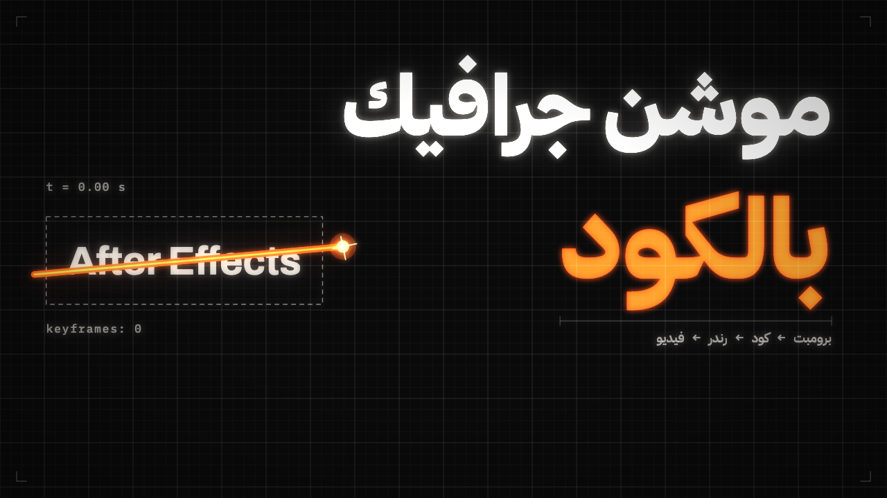
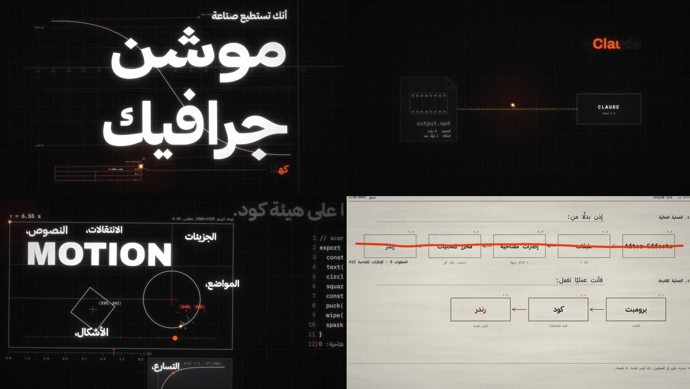

<div dir="rtl">

# Motion Starter Kit: فيديو موشن جرافيك من فيديو مرجعي

[](https://youtu.be/yreYVMWULLc)

▶️ **[شاهد الفيديو على يوتيوب](https://youtu.be/yreYVMWULLc)**: هذا الفيديو كله صُنع بـ Remotion بالكلام مع Claude Code، وهو ستايل `plotter` في المكتبة.

اختر ستايلًا من [مكتبة الستايلات](styles/README.md)، أو ضع أي فيديو موشن جرافيك يعجبك في `reference/`. ثم افتح المشروع في وكيل برمجة (Claude Code أو Codex أو Antigravity)، والصق [البرومبت](PROMPT.md).

بعدها يتولّى الوكيل الباقي:
1. يحلّل فيديو الستايل بنفسه، ويكتب دليل أسلوبه في `STYLE.md`.
2. يسألك كل أسئلته مرة واحدة: الموضوع، والمدة، واللغة، وتعليق صوتي أم مؤثرات فقط.
3. يكتب السكريبت وخطة المشاهد.
4. يبني الفيديو بـ **Remotion**، مشهدًا بعد مشهد، وكل حركة مربوطة بتوقيت كلماتها.
5. يفتح لك **Remotion Studio** لتشاهد الفيديو.
6. **لا يرندر** حتى تقول «رندر».

القواعد واحدة لكل الوكلاء، لذلك يمكنك إعطاء نفس المشروع لأكثر من وكيل، ومقارنة ما يصنعه كل واحد.

## الستايلات
| الاسم | المعاينة |
|---|---|
| `plotter` |  |

التفاصيل وطريقة إضافة ستايل جديد في [styles/README.md](styles/README.md).

## المتطلبات
| الأداة | لماذا | التثبيت |
|---|---|---|
| Node.js 18+ | Remotion | [nodejs.org](https://nodejs.org) |
| ffmpeg | تحليل الفيديو والصوت | macOS: `brew install ffmpeg`، Windows: `winget install ffmpeg` |
| uv | تشغيل سكريبتات Python دون إعداد | [docs.astral.sh/uv](https://docs.astral.sh/uv/getting-started/installation/) |

أول مرة تستخرج فيها توقيت تعليق صوتي، يُحمَّل PyTorch وموديل المحاذاة، ومجموعهما نحو 2 جيجا. وبعدها تعمل الأداة دون إنترنت.

## الاستخدام
| الوكيل | كيف تفتح المشروع |
|---|---|
| **Claude Code** | افتح هذا المجلد في Claude Code (التطبيق أو الطرفية). يقرأ `CLAUDE.md` والسكيل من `.claude/skills/` |
| **Codex** | شغّل Codex في هذا المجلد. يقرأ `AGENTS.md` والسكيل من `.agents/skills/` |
| **Antigravity** | افتح المجلد كـ workspace. يقرأ `AGENTS.md` و`GEMINI.md` والسكيل من `.agents/skills/` |

ثم الصق البرومبت من [PROMPT.md](PROMPT.md).

## خريطة المشروع
```
styles/             مكتبة الستايلات: لكل ستايل فيديو ومعاينة
reference/          أو ضع هنا فيديو مرجعيًا من عندك
AGENTS.md           القانون: القواعد لكل الوكلاء
CLAUDE.md           يستورد AGENTS.md لـ Claude Code
GEMINI.md           يستورد AGENTS.md لـ Antigravity
PROMPT.md           البرومبت الذي تلصقه
.agents/skills/motion-from-reference/
  SKILL.md          الطريقة، مرحلة بمرحلة
  references/       الأسئلة، وقالب دليل الأسلوب، وقواعد Remotion والعربية والصوت والمراجعة
  scripts/          analyze.py (تحليل المرجع)، وalign.py (توقيت الكلمات)، وsfx.py (مؤثرات صوتية)
.claude/skills/     نفس السكيل لـ Claude Code
video/              مشروع Remotion (تبنى فيه المشاهد)
```

ويكتب الوكيل في جذر المشروع: `STYLE.md` و`PLAN.md` و`script.txt`، وفي `analysis/` نتائج تحليل المرجع.

## الأوامر (داخل `video/`)
| الأمر | ماذا يفعل |
|---|---|
| `npm run studio` | يفتح Remotion Studio للمعاينة |
| `npm run stills -- 3 7.5` | صور ثابتة عند ثوانٍ محددة |
| `npm run render -- --approved` | الرندر الكامل، بعد موافقتك فقط |

## عن المرجع
- استخدم فيديوهات من حقك أن تتعلم منها.
- الوكيل يأخذ **الأسلوب** فقط، ولا ينسخ الشعارات ولا النصوص ولا الصور.

## الرخصة
MIT: استخدمه وعدّله وانشره بحرية. انظر [LICENSE](LICENSE).

</div>
