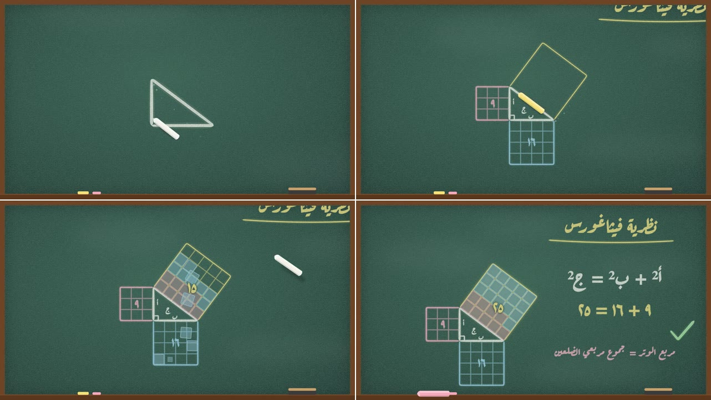
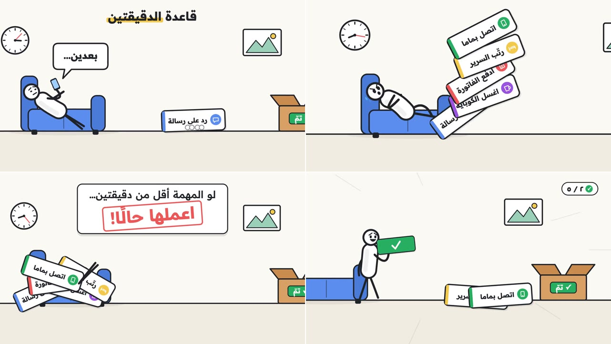
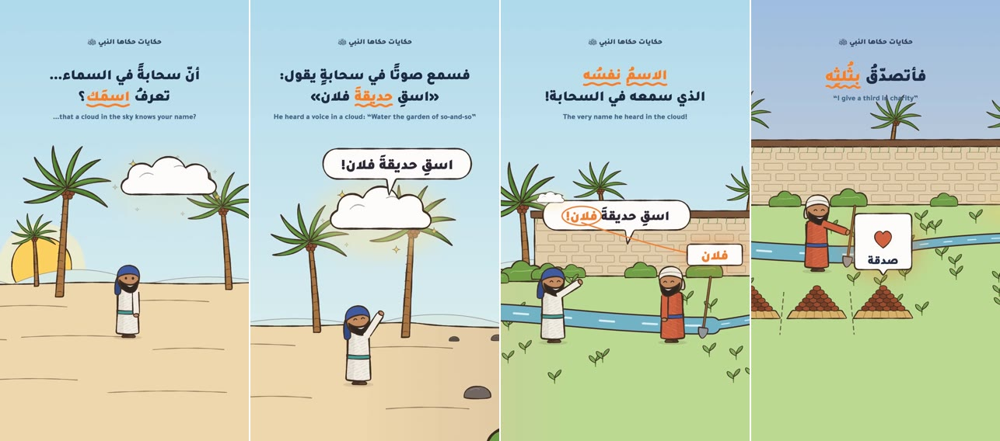

<div dir="rtl">

# مكتبة الستايلات

اختر ستايلًا بالاسم في البرومبت، مثل: «أريد فيديو بستايل plotter»، أو «أريد ريل بستايل doodle»، أو «أريد درسًا بستايل whiteboard»، أو «اشرح لي قانونًا بستايل chalkboard»، أو «أريد نصيحة في قصة بستايل stickman». سيحلّل الوكيل فيديو الستايل ويفهمه بنفسه، ثم يصنع فيديو جديدًا بموضوعك.

| الاسم | المعاينة | الوصف |
|---|---|---|
| `plotter` |  | ستايل البلوتر: قلم بشرارة برتقالية يرسم على ورق مربعات، وكلمات تضيء مع الصوت، و3 ألوان فقط. [التفاصيل](plotter/README.md) |
| `whiteboard` |  | ستايل السبورة البيضاء: ماركر يرسم ويلوّن ويكتب خطوة بخطوة، والكاميرا تقترب من كل جزء، والرسمة تعيش بعد اكتمالها. [التفاصيل](whiteboard/README.md) |
| `chalkboard` |  | ستايل السبورة والطباشير: طباشيرة ترسم وتكتب على سبورة خضراء، وتتساقط منها ذرات، مع إثبات بصري متحرك. [التفاصيل](chalkboard/README.md) |
| `stickman` |  | ستايل الشخصية العصوية: شخصية مرنة بجسم أبيض ويدين ورجلين من العصيّ، ووجه معبّر، في قصة كوميدية بمؤثرات. [التفاصيل](stickman/README.md) |
| `doodle` |  | ستايل الدودل: شخصيات كرتونية بالحبر تمشي في عالم واحد بلا قطع، وكلام كلمة كلمة بكلمة مميزة متوهجة. طولي للريلز. [التفاصيل](doodle/README.md) |

## إضافة ستايل جديد
1. أنشئ مجلدًا باسم الستايل: `styles/<الاسم>/`. استخدم حروفًا إنجليزية صغيرة وبدون مسافات.
2. ضع فيه:
   - **`reference.mp4`:** الفيديو، بدقة 720p وحجم أقل من 50 ميجا.
   - **`preview.jpg`:** 4 لقطات من الفيديو في صورة واحدة.
   - **`README.md`:** الاسم، ووصف من سطر واحد، والمصدر.
3. أضف سطرًا للستايل في الجدول أعلاه.

**صنع `preview.jpg`:** من جذر المشروع، غيّر أرقام الإطارات لتختار لقطات تمثّل الستايل:
```
ffmpeg -i styles/<الاسم>/reference.mp4 -vf "select='eq(n\,100)+eq(n\,1000)+eq(n\,1800)+eq(n\,2600)',scale=640:-2,tile=2x2" -frames:v 1 styles/<الاسم>/preview.jpg
```

</div>
